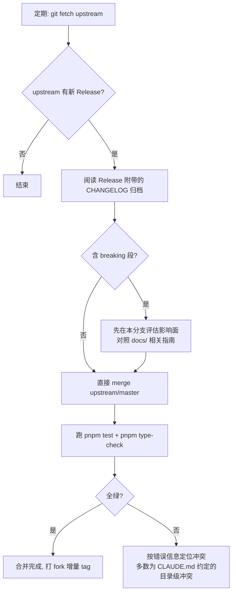

# Fork 升级与版本策略

> 适用：将本仓库 fork 为团队/个人基线的消费者，以及本仓库的发布者。
>
> 核心问题三个：我在用哪个版本？上游更新了我怎么跟？ breaking 变更什么时候会来？

## 1. 版本口径（先读这个）

| 事实源                           | 说明                                               |
| -------------------------------- | -------------------------------------------------- |
| `package.json` 的 `version` 字段 | 版本号唯一事实源                                   |
| git tag（`v*`）                  | `pnpm release` 发布时自动创建，与 version 字段一致 |
| GitHub Releases 页面             | 每个 tag 自动生成 Release，附 CHANGELOG 归档内容   |

- **开源首发版 = v1.0.0**（2026-10-15 添加 MIT LICENSE 后）。
- CHANGELOG 历史中的 `v3.5` / `v3.6` 等 `v3.x` 段是**内部开发期版本叙事**，仅保留为开发历史，与现行 semver 无对应关系。 fork 后判断"我落后上游多少"，只看 GitHub Releases 的 tag 列表。

## 2. 首次 fork：关联 upstream

```bash
git clone <你的 fork 地址> my-project
cd my-project
git remote add upstream git@github.com:Mr-Super-X/vue3-vite-project.git
git fetch upstream
```

- `origin` = 你的 fork；`upstream` = 本模板
- fork 后第一步建议：打一个你自己的基线 tag（如 `v1.0.0-fork.1`），让"我改过什么"永远可 diff

## 3. 跟进升级流程



要点：

- **节奏建议**：上游是"能力波次"式发布（一次一个大特性），每 1-3 个月看一次 Releases 即可，不必追每次提交。
- **合并策略**：上游仓库对 workspace 有严格的 apps/packages 结构锁（见 CLAUDE.md §2 Architecture Lockdown），冲突通常集中在 `apps/<a>/src/modules/<你的业务模块>/` 与上游新增文件，极少波及你的业务代码。
- **不建议 rebase 跟进**：fork 基线一旦被你的团队基于，rebase 会重写共享历史；merge 保留分叉点，回溯容易。

## 4. Breaking 政策（semver 约定）

| 版本段           | 含义             | 本仓库承诺                                                     |
| ---------------- | ---------------- | -------------------------------------------------------------- |
| `major`（2.0.0） | 破坏性变更       | 提前在 CHANGELOG"未发布"段标注 BREAKING，并在 Release 说明置顶 |
| `minor`（1.1.0） | 向后兼容的新能力 | 新布局/新组件走这里；使用指南随 Release 同步                   |
| `patch`（1.0.1） | 修复             | 随时发布                                                       |

- 发布前必跑 `pnpm test` + `pnpm type-check`（release-it hooks 已内置强制）。
- 引擎要求（Node `^22.18 \|\| >=24.12`、pnpm `>=11 <13`）的**收紧**会视为 minor 而非 major，但会在 Release 说明中置顶提醒——升级前先看引擎段。

## 5. 发布者侧（本仓库维护者）

```bash
# 前提：在 master 分支 + 工作区干净（dry-run 与正式 release 执行同一套前置校验）
git switch master
pnpm release:dry   # 干跑：预览版本号与 hooks 校验，0 副作用
pnpm release       # 正式：type-check + test → bump → tag → push → GitHub Release
```

- release-it 配置（`.release-it.json`）：tag 名 `v${version}`；`npm.publish: false`（模板不走 npm 分发）；`github.release: true`（tag 推送后自动生成 GitHub Release，fork 者据此跟进）。
- `requireBranch: ["master", "release/*"]` + `requireCleanWorkingDir` + `requireUpstream` **对 dry-run 同样生效**（release-it 的设计：预览即模拟真实发布的全部前置校验）。在 `feature/*` 分支或未提交改动状态下跑 `pnpm release:dry` 会报 `Must be on branch master,release/*`——这是保护在正常工作，不是故障。
- CHANGELOG 纯手写（2026-10-27 起 `@release-it/conventional-changelog` 插件已下线，见 docs/03 §发版时 CHANGELOG 处理）：发版时**手工**把顶部 `## 未发布` 标题改为版本段（`## v${version} (YYYY-MM-DD)`）并单独 commit——release-it 不再参与生成，也不存在"自动归档"。

## 6. 相关文档

| 文档                                  | 关系                                                      |
| ------------------------------------- | --------------------------------------------------------- |
| [CHANGELOG.md](../CHANGELOG.md)       | 版本口径声明与本文件互为引用                              |
| [docs/10-新手指引.md](10-新手指引.md) | 新 fork 者的 30 分钟上手路径                              |
| [CLAUDE.md](../CLAUDE.md) §2          | apps/packages Architecture Lockdown（预判合并冲突的依据） |
