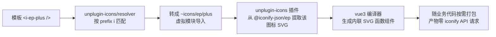

# 39-图标体系与使用规范

> **版本**：v1.0.0 | **生效日期**：2026-10-20 | **配套 demo**：`/demo/icon`
>
> 一套语法、零体积焦虑、类型安全、离线可用的团队级图标方案。

| 属性     | 值                                                          |
| -------- | ----------------------------------------------------------- |
| 静态用法 | `<i-集合-图标 />`（如 `<i-ep-plus />`）                     |
| 动态用法 | `<AppDynamicIcon name="集合:图标" />`                       |
| 可用集合 | `ep`（Element Plus）/ `tabler`（Tabler）/ `app`（项目本地） |
| 生产请求 | 零外部请求（编译期内联 SVG）                                |
| 新人上手 | 复制本文示例即可                                            |

---

## 1. 原理

### 1.1 编译期解析链路



- **按需打包**：只打包模板里实际用到的图标，`@iconify-json/*` 全集合（数千图标）不进产物
- **离线可用**：SVG 在编译期内联为 JS 组件，dev / build / 生产运行全程零网络请求
- **类型安全（验收#2 的双层拦截）**：
  1. **IDE 期**：用过的图标进 `src/types/components.d.ts`（本地 dev/build 自动生成，已 gitignore），Volar 有补全；写错名字的 `i-*` 标签不在 GlobalComponents 中，IDE 直接标「找不到组件」
  2. **构建期**：图标名错误 → 虚拟模块解析失败 → `pnpm dev` 终端/浏览器报错、`pnpm build` 直接失败
- **currentColor 化**：`app` 集合的本地 SVG 经 `FileSystemIconLoader` transform 把非 `none` 的 `fill`/`stroke` 强制替换为 `currentColor`，图标颜色完全跟随 CSS `color`

### 1.2 关键依赖与配置位置

| 关注点                                 | 位置                                                      |
| -------------------------------------- | --------------------------------------------------------- |
| Icons 插件（编译器 + app 集合 loader） | `vite.config.ts` → `Icons({...})`                         |
| 标签解析（prefix / 放行集合）          | `vite.config.ts` → `IconsResolver({...})`                 |
| 动态图标注册表                         | `src/assets/icons/registry.ts`                            |
| 动态组件                               | `src/components/common/AppDynamicIcon.vue`                |
| 全局组件类型                           | `src/types/components.d.ts`（本地自动生成，已 gitignore） |
| 虚拟模块类型声明                       | `src/types/env.d.ts`（`unplugin-icons/types/vue`）        |

---

## 2. 三种用法

### 2.0 去哪找图标（新人必读）

| 集合          | 查找地址                                                                               | 命名技巧                                                                                                                                          |
| ------------- | -------------------------------------------------------------------------------------- | ------------------------------------------------------------------------------------------------------------------------------------------------- |
| `ep`          | [element-plus.org/zh-CN/component/icon](https://element-plus.org/zh-CN/component/icon) | EP 官方图标页。图标名 = EP 组件名转 kebab-case：`Plus` → `i-ep-plus`、`MagicStick` → `i-ep-magic-stick`（每个大写字母前加 `-` 后全小写）          |
| `tabler`      | [icon-sets.iconify.design/tabler](https://icon-sets.iconify.design/tabler/)            | 图标名本身就是 kebab-case，直接拼 `i-tabler-<名字>`（如 `chart-bar`）。业务图标首选扩展库（4000+）                                                |
| 全集合搜索    | [icon-sets.iconify.design](https://icon-sets.iconify.design/)                          | iconify 全集合搜索，**支持中文**搜「设置」「下载」等直达图标。⚠️ 项目白名单仅 `ep` / `tabler` / `app`，搜到其他集合的名字须先走 §3.1 新增集合流程 |
| `app`（本地） | `src/assets/icons/`（本仓库目录）                                                      | 业务私有图标，git 管理；新增三步走见 §3.2 / §3.3                                                                                                  |

> 找不到想要的图标时：先在 iconify 全集合搜索中文关键词 → 命中 `ep`/`tabler` 直接用；命中其他集合（如 `mdi`）评估是否值得加白名单；都没有再考虑自绘 SVG 进 `app:` 集合。

### 2.1 静态用法（首选，99% 场景）

模板直接写 `<i-集合-图标 />`，**不要 import**（unplugin 自动解析）：

```vue
<template>
  <!-- Element Plus 官方图标（与 @element-plus/icons-vue 同名互转 kebab-case） -->
  <i-ep-plus />
  <i-ep-edit />

  <!-- Tabler 通用图标库（4000+，业务首选扩展库） -->
  <i-tabler-home />
  <i-tabler-settings />
</template>
```

- **尺寸**：默认 `1.2em`（unplugin-icons `scale` 默认值），跟随父级 `font-size`
- **颜色**：默认继承 CSS `color`（iconify 集合本身即 currentColor 规范）
- 改尺寸/颜色就用 CSS，不要给 `i-*` 标签加 width/height/color 属性

```vue
<span style="font-size: 24px; color: var(--el-color-primary)">
  <i-ep-plus />
</span>
```

### 2.2 动态用法（图标名来自数据时）

图标名是运行时才确定的字符串（后端菜单配置、JSON schema、循环渲染）时用 `AppDynamicIcon`：

```vue
<script setup lang="ts">
// name 类型为 AppIconName（registry key 联合），写错 vue-tsc 直接报错
const menuItems = [
  { title: '首页', icon: 'tabler:home' },
  { title: '设置', icon: 'tabler:settings' },
] as const
</script>

<template>
  <AppDynamicIcon v-for="m in menuItems" :key="m.title" :name="m.icon" />
  <AppDynamicIcon name="ep:plus" :size="20" />
</template>
```

- **size**：透传 SVG 的 width/height（px），不传则跟随 `font-size`
- **name 的外部数据守卫**：后端返回的不可信字符串先过 `isAppIconName` 守卫再传入：

```ts
import { isAppIconName } from '@/assets/icons/registry'

const safeName = isAppIconName(rawName) ? rawName : 'app:logo'
```

### 2.3 本地自定义集合 `app:`（团队自有图标）

业务私有图标（品牌 logo、插画性图标）放 `src/assets/icons/*.svg`，经 `app:` 集合使用：

```vue
<template>
  <i-app-logo />
  <i-app-close />
</template>
```

- SVG 源文件即代码资产，git 管理、编译期校验、随包分发
- 支持静态 `<i-app-xxx />` 与动态（registry 登记 `'app:xxx'`）两种消费方式
- 源文件规范见 §4.3

---

## 3. 新增流程

### 3.1 新增一个图标的使用（ep / tabler 已有图标）

1. 在 [icon-sets.iconify.design](https://icon-sets.iconify.design) 搜索确认图标名（如 `tabler: adjustments`）
2. 模板直接写 `<i-tabler-adjustments />`，dev 保存即生效

> 若引入**新集合**（如 `mdi`）：`pnpm add -D @iconify-json/mdi`，并把集合名加进 `vite.config.ts` 的 `IconsResolver.enabledCollections`（否则标签不被解析，构建期报「找不到组件」——这是故意的拦截设计）。

### 3.2 新增本地 `app:` 图标

1. 把设计师给的 SVG 清理后存入 `src/assets/icons/<kebab-case 名>.svg`（规范见 §4.3）
2. 静态用法直接 `<i-app-<文件名> />`；动态用法需另在 `registry.ts` 登记（见 3.3）

### 3.3 新增动态图标（registry 登记）

`src/assets/icons/registry.ts` 加一行 import + 一个表项：

```ts
import TablerAdjustments from 'virtual:icons/tabler/adjustments'

const registry = {
  // ...已有项
  'tabler:adjustments': TablerAdjustments,
} as const
```

`AppIconName` 联合类型自动扩展，**无需改 AppDynamicIcon 组件**。提交后团队成员立即可用（类型随 registry 走，不依赖 components.d.ts 刷新）。

---

## 4. 规范

### 4.1 何时用哪种

| 场景                              | 用法                                                                                                   |
| --------------------------------- | ------------------------------------------------------------------------------------------------------ |
| 模板里图标固定不变                | 静态 `<i-集合-图标 />`（首选）                                                                         |
| 图标名来自数据/配置（菜单、循环） | `AppDynamicIcon`                                                                                       |
| 需要整体换色/跟随主题             | 两种都行（均已 currentColor 化），用 CSS `color` 控制                                                  |
| 多色品牌图标 / 插画               | 走 `` / CSS 背景——`app:` 集合的 currentColor transform 是全集合生效的，**没有部分保留颜色的机制** |

### 4.2 命名

- 标签一律 `i-<集合>-<图标名>`（kebab-case），集合与图标名之间用 `-` 连接
- 动态名一律 `集合:图标`（冒号语法），与标签的 `<集合>-<图标>` 一一对应
- 本地 SVG 文件名 kebab-case（`logo.svg`、`close.svg`）

### 4.3 本地 SVG 源文件规范

```svg
<svg xmlns="http://www.w3.org/2000/svg" viewBox="0 0 24 24" fill="none">
  <path fill="#409EFF" d="..." />
</svg>
```

| 项         | 要求                                                                                         | 原因                                                                           |
| ---------- | -------------------------------------------------------------------------------------------- | ------------------------------------------------------------------------------ |
| 根元素     | 必须 `viewBox`，推荐 24×24 与主流集合对齐                                                    | 尺寸一致性                                                                     |
| 根 `fill`  | 写 `fill="none"` 或不写                                                                      | 根 fill 不参与替换，避免子元素意外继承                                         |
| 子元素颜色 | 单色图标写任意色值（会被 transform 替换为 currentColor）                                     | loader 的正则只替换非 none 的 fill/stroke                                      |
| 属性书写   | 一律双引号紧凑写法（`fill="#000"`），不写单引号 / 等号带空格 / 无引号                        | transform 正则是简单匹配，非双引号写法**不会被替换**、图标静默保留原色且无告警 |
| 多色图标   | 需要保留的颜色**没有机制**——`app:` 集合默认全量 currentColor 化，多色请走 `` / CSS 背景 | currentColor transform 是全集合生效的                                          |
| 清理       | 提交前过一遍 [SVGOMG](https://jakearchibald.github.io/svgomg/)（去编辑器元数据）             | 体积                                                                           |

### 4.4 禁止行为

| #   | 禁止                                                       | 原因                                                                                   |
| --- | ---------------------------------------------------------- | -------------------------------------------------------------------------------------- |
| 1   | `import { Plus } from '@element-plus/icons-vue'`（新代码） | 与 i-标签双语法并存，走 unplugin-icons 统一体系（既有代码不在本次迁移范围）            |
| 2   | `<script>` 里 `import X from 'virtual:icons/...'` 手动导入 | 破坏「模板即全部用法」约定；确需构造类型引用时例外（CLAUDE.md §1.7 InstanceType 场景） |
| 3   | 给 `i-*` 标签写 `color` / `width` / `height` 属性          | 用 CSS 控制；属性方式与 currentColor 体系冲突                                          |
| 4   | 新增图标不验证名字（凭记忆写 `<i-ep-xxx />`）              | 构建期才暴露错误；先在 icon-sets.iconify.design 查证                                   |
| 5   | 给装饰图标加无障碍文本                                     | 已统一 `aria-hidden`（AppDynamicIcon 内置；静态 i-标签编译产物默认 aria-hidden）       |

---

## 5. FAQ

**Q1：写了一个 `<i-ep-xxx />`，dev 报「Failed to resolve component」？**
名字不在 ep 集合中。到 icon-sets.iconify.design 的 ep 分区查证准确名字；若要用其他集合，先走 §3.1 新集合流程。

**Q2：`<i-mdi-home />`（白名单外集合）会怎样？**
`mdi` 不在 `enabledCollections` 白名单（当前仅 ep / tabler / app）→ resolver 不解析该标签 → 运行时 Vue warn「找不到组件」且不渲染任何内容（vite build 本身不失败）。注意这与「白名单内图标名写错」不同：`ep` 内的错误名字会被 resolver 解析为 `~icons/ep/xxx` 虚拟模块 → **dev/build 双双报错**（`Icon ep/xxx not found`，已实测）。如需启用 mdi 走 §3.1 流程。

**Q3：components.d.ts 需要提交吗？**

不提交（已 gitignore，与 auto-imports.d.ts 同策略）。它是 unplugin-vue-components 的自动生成物，内容随「最近一次 dev/build 类型 + transform 到的组件」摇摆——`pnpm build` 会因 demo 页 DEV 门控冲掉 i- 图标条目，dev 访问后又补回，**入库必然产生「提交后必带未提交变更」的 dirty 噪音**（2026-10-20 实测回退此决策）。

- type-check 依赖由 build 脚本保证：`pnpm build` = `build-only`（生成最新 dts）→ `type-check:full`，已验证全绿
- clone 后首次 `pnpm dev` / `pnpm build` 自动生成本地副本；日常开发开着 dev 自然常新
- **不要手工编辑**（下次生成会被覆盖）

**Q4：动态图标为什么要 registry 中转，不直接用 @iconify/vue？**
`@iconify/vue` 的离线模式需 `addIcon(name, data)` 注入图标数据，而 `@iconify-json/*` 只提供整集合单文件 JSON（整包导入会让 ep 全部 ~600 图标进 bundle）。registry 查表法用 `virtual:icons/*` 编译期导入，保持按需打包 + 类型联合 + 离线三不误，故未引入 `@iconify/vue`。

**Q5：断网能跑吗？**
能。SVG 全部编译期内联，dev / build / preview 全程零 iconify 网络请求（验收#3/#4 的验证方式：断网跑 dev + build 后搜产物无 `api.iconify.design`）。

**Q6：已有 `<el-icon><Plus /></el-icon>` 代码要迁移吗？**
本次不强制迁移（既有代码不受影响）。新代码统一 i-标签语法；存量迁移单独立项。

**Q7：`app:` 集合图标在 registry 与文件命名不一致时报什么错？**
registry import 一个不存在的 `virtual:icons/app/xxx` → 构建期虚拟模块解析失败，终端明确指出图标名与集合。

---

## 6. 目录说明

```text
src/
├── assets/
│   └── icons/                  # app 集合：本地 SVG 资产（git 管理）
│       ├── logo.svg            #   品牌 logo 示例
│       ├── close.svg           #   关闭图标示例
│       └── registry.ts         #   动态图标注册表（name→组件映射 + AppIconName 类型）
├── components/common/
│   ├── AppDynamicIcon.vue      # 动态图标壳组件（全局自动注册）
│   └── AppDynamicIcon.spec.ts  # 查表渲染/属性透传/a11y 单测
├── modules/demo/examples/Icon/
│   └── index.vue               # demo 页（/demo/icon，自动路由）
└── types/
    ├── components.d.ts         # GlobalComponents 精确类型（自动生成，已 gitignore）
    └── env.d.ts                # virtual:icons 模块类型声明
```

构建侧（`src/` 之外）：

```text
vite.config.ts                  # Icons 插件 + IconsResolver（prefix i，白名单 ep/tabler/app）
package.json                    # unplugin-icons / @iconify-json/ep / @iconify-json/tabler（devDependencies）
```

---

_文档版本：v1.0.0 | 生成日期：2026-10-20 | 配套验收：type-check:full + test + build 全绿，dev 断网实测_
