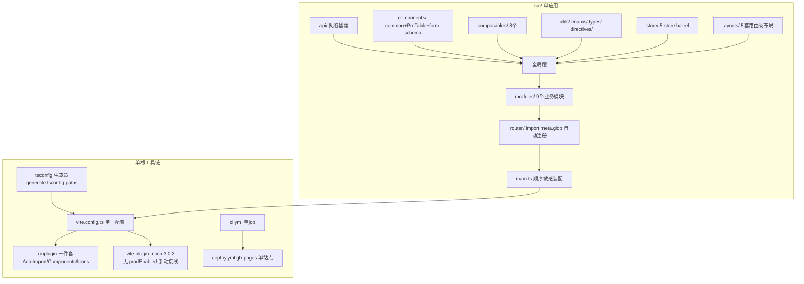
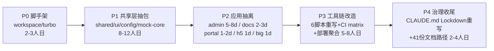
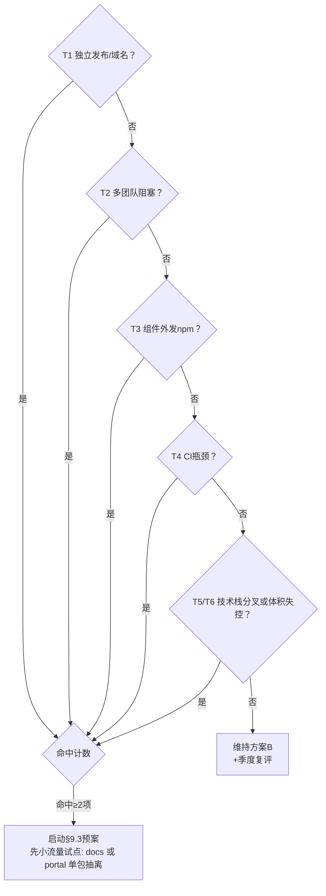

# 42-Monorepo 多应用改造评估

> **TL;DR**：当前架构通过「Feature-Sliced 模块 + 5 套路由级布局 + 路由前缀」已实现了准多应用能力，常规产物实测 36 chunk/4.0M（演示构建 182 chunk/11M）。Monorepo 改造预估 **27~42 人日** + 后续常态 +20~30% 运维心智成本，而评估的 6 项迁移触发条件当前命中 **0 项**。**结论：现在不改造**；建议以 3 项低成本强化继续走单应用路由前缀方案，并保留一份触发即启动的 4 阶段迁移预案（§9）。

---

## 1. 背景与评估目标

本仓库定位是 **Vue3 企业中后台工程模板**（Feature-Sliced 单体，约 660 个 .ts/.vue 文件、src 约 10.7 万行）。随着 home 门户站（`portal` 布局）、h5-demo（`h5` 布局）、big-demo（`big` 布局）、demo 文档站的落地，仓库内实际上已并存 5 种"应用形态"。由此产生一个问题：**是否应升级为 Monorepo 多应用仓库（apps + packages）？**

本文回答四个问题：

1. 现状架构离 Monorepo 有多远（耦合点清单）？
2. Monorepo 与"单应用路由前缀"两种方案在本项目的真实优缺点？
3. 若改造，成本是多少（逐项人日估算）？
4. 现在有没有改造的必要（触发条件评估）？

---

## 2. 现状架构事实（评估依据）

### 2.1 规模与模块清单

| 维度       | 实测数据                                                                                                                    | 来源                                      |
| ---------- | --------------------------------------------------------------------------------------------------------------------------- | ----------------------------------------- |
| src 文件数 | 660 个 .ts/.vue                                                                                                             | `find src` 实测                           |
| 代码规模   | modules 39.9k 行 / components 52.3k 行 / layouts 5.5k 行（含 .scss，量级参考）                                              | `wc -l` 实测                              |
| 业务模块   | 9 个：auth、user、reports、workbench、home、demo、h5-demo、big-demo、error                                                  | `src/modules/`                            |
| 路由级布局 | 5 套：default / portal / blank / h5 / big（各自自包含 components+config+styles）                                            | `src/layouts/`                            |
| 全局 Store | 5 个（app/user/theme/tags-view/dict），barrel 统一出口                                                                      | `src/store/index.ts`                      |
| 路径别名   | 16 个（15 个 src 别名 + `@mock`），单一来源 + CI 门禁                                                                       | `build/aliases.ts` + `pnpm check:aliases` |
| 工程脚本   | 6 个自研脚本（check-routes / check-aliases / check-doc-currency / new-module / remove-module / generate:tsconfig-paths 等） | `scripts/` + `build/scripts/`             |
| 编号文档   | 41 份，13 项硬数据被 `check:doc-currency` 锁定                                                                              | `docs/`                                   |

### 2.2 现状结构图



### 2.3 现状耦合点清单（改造成本的直接来源）

| #   | 耦合点                                                                                                                                                                                | 位置                                                | Monorepo 化的影响                                                                                                                             |
| --- | ------------------------------------------------------------------------------------------------------------------------------------------------------------------------------------- | --------------------------------------------------- | --------------------------------------------------------------------------------------------------------------------------------------------- |
| C1  | 路由自动注册基于 `import.meta.glob` **编译期字面量** `/src/modules/**/routes/index.ts`                                                                                                | `src/router/auto-register.ts:49`                    | 每个 app 需各自 glob 或改造为传参工厂；远程菜单 `COMPONENT_REGISTRY` 同改                                                                     |
| C2  | 全局组件双注册机制：unplugin `dirs` 三目录（deep）+ `@components` 插件再 glob `./common/**` eager                                                                                     | `vite.config.ts:110` + `src/components/index.ts:27` | 共享组件迁入 `packages/` 后，每个 app 的 vite 配置都要跨包扫描（pnpm 符号链接下 deep 扫描），或改为构建期产物包                               |
| C3  | AutoImport 以 `@/composables/*` 路径注入 8 个 composable + `createNamespace`，dts 固定输出 `src/types/`                                                                               | `vite.config.ts:48-78`                              | 别名若改为 workspace 包名，660 文件 import 面需 codemod；若保留 alias 则 alias 目标改指 `packages/*`                                          |
| C4  | SCSS `additionalData` 统一注入 `$BEM_PREFIX` + bem mixin                                                                                                                              | `build/scss.ts`（vite.config.ts:151 消费）          | 每 app 重复该配置，需抽公共 vite config helper 包                                                                                             |
| C5  | mock 双接线：dev `mock/index.ts` 聚合 + prod `mockProdServer.ts` 手动 import 清单                                                                                                     | `mock/index.ts` + `mock/mockProdServer.ts`          | 迁包后两清单跨包维护；已有"删 mock 文件三处同步"的踩坑记录                                                                                    |
| C6  | httpOnly cookie 会话模式                                                                                                                                                              | CLAUDE.md §1.3                                      | **多 origin 部署（每 app 独立域名/端口）必须解决 SSO 或父域共享 cookie**，否则登录态不漫游                                                    |
| C7  | `router/index.ts` afterEach 直接依赖 tags-view store；守卫依赖 user/app store                                                                                                         | `src/router/index.ts:65`                            | router 作为共享包时，store 必须同包或定义接口注入                                                                                             |
| C8  | `main.ts` 顺序敏感装配（brandColor → prod mock await → use 链 → setDialogAppContext）                                                                                                 | `src/main.ts`                                       | 每 app 复制该装配序列，或抽 `createApp` 工厂包                                                                                                |
| C9  | postcss-pxtorem 按目录前缀约定只转换 h5 目录                                                                                                                                          | `build/postcss.ts`                                  | 多 app 下 h5 app 独立配置即可（反而更干净）                                                                                                   |
| C10 | vendor chunks 顺序敏感 `manualChunks`、产物分目录规则                                                                                                                                 | `build/vendor-chunks.ts` + vite.config.ts:214       | 每 app 复制；改公共包                                                                                                                         |
| C11 | 6 个工程脚本全部假设单根 `src/`：check-routes 扫 `src/modules/**`、new-module/remove-module 写 `src/modules/`、check:aliases 锁 `build/aliases.ts`、check-doc-currency 锁 13 项硬数据 | `scripts/`                                          | 全部重写为多包感知；文档硬数据锁同步失效重建                                                                                                  |
| C12 | 根级单配置：vitest.config.ts / playwright.config.ts / uno.config.ts                                                                                                                   | 仓库根                                              | 改 per-package 或 root 别名到 packages/*（二选一都有工作量）                                                                                  |
| C13 | CI 单 job + gh-pages 单站点 hash 部署（4 个 VITE_* 开关 + VITE_DEMO_NO_AUTH）                                                                                                         | `.github/workflows/`                                | 改 build matrix + 产物聚合；**GitHub Pages 单站点多 app 只能 path 前缀 + 每 app base，且 Pages 仅支持一个 404.html**，SPA fallback 成为真问题 |
| C14 | CLAUDE.md §2「src/ Architecture Lockdown」+ BEM 强约束 + §1.7 全局注册约束，全文路径引用                                                                                              | CLAUDE.md / 41 份 docs                              | 治理规则整体改写，文档路径引用批量更新                                                                                                        |

---

## 3. 现状的"准多应用"能力（方案 B 的证据）

本项目**并不是**典型的"一个应用越写越大"。它已经具备了 Monorepo 想要的大部分隔离收益：

| 能力         | 现状落地方式                                                               | 证据                                                                   |
| ------------ | -------------------------------------------------------------------------- | ---------------------------------------------------------------------- |
| 应用形态隔离 | 5 套路由级布局，互不复用组件（§1.2 铁律禁止跨 layout 引用）                | `src/layouts/*` 各自 components/config/styles                          |
| 路由前缀区分 | `/home`（portal）、`/h5-demo`（h5）、`/big-demo`（big）、`/demo`（文档站） | 各模块 `routes/index.ts`                                               |
| 构建期剔除   | DEV 门控：常规 prod 构建整体 tree-shake 剔除 demo 路由 + glob 组件         | CLAUDE.md v2.2.1：实测 **36 chunk/4.0M** vs 演示构建 **182 chunk/11M** |
| 公开访问控制 | 白名单按 name 豁免（`ROUTE_WHITE_LIST` + `demoWhitelistNames`）            | `src/router/whitelist.ts`                                              |
| 模块边界     | 模块间通信只走 `modules/<m>/index.ts` 对外接口，禁止直 import 内部文件     | CLAUDE.md §1.2                                                         |
| 布局自包含   | layout 禁止引用 `@/components/` 下任何内容                                 | CLAUDE.md §1.2                                                         |

**关键判断**：方案 B 在当前仓库不是"待实现方案"，而是**已运行中的现状**；评估的本质是"要不要用 Monorepo 替换一个已经工作的隔离机制"。

---

## 4. 候选方案定义

### 方案 A：Monorepo 多应用仓库

```
vue3-vite-project/
├── pnpm-workspace.yaml
├── turbo.json（或 nx.json）
├── packages/
│   ├── shared/        # utils + enums + types + api + composables + directives
│   ├── ui/            # components/common + ProTable + form-schema + assets/icons + styles
│   ├── config/        # @acme/vite-config（scss注入/vendor chunks/别名工厂）
│   └── mock-core/     # mock 公共数据 + prodServer 框架
└── apps/
    ├── admin/         # default layout + auth/user/reports/workbench/error
    ├── portal/        # home 门户站
    ├── docs/          # demo 文档站
    ├── h5/            # h5-demo
    └── big/           # big-demo
```

工具链：pnpm workspace（必选）+ Turborepo 或 Nx（affected 构建/缓存，可选但几乎必配）。

### 方案 B：单应用路由前缀（现状强化）

保持单 `src/` + 单 vite config，继续以「模块 × 布局 × 路由前缀 × 构建开关」区分应用形态；补强点见 §9.2。

### 方案 C：单仓 Vite MPA 多入口（仅备查）

`build.rollupOptions.input` 声明多个 html 入口，1~2 人日即可。代价：各入口是独立 Vue 实例，pinia/tags-view 状态不漫游、构建图仍耦合。仅在"需要同源独立 HTML 入口"的窄场景考虑，不构成 Monorepo 替代。

---

## 5. 方案对比矩阵

| 维度          | A：Monorepo                                             | B：单应用路由前缀（现状）                 | 本项目评注                                             |
| ------------- | ------------------------------------------------------- | ----------------------------------------- | ------------------------------------------------------ |
| 应用隔离级别  | 构建期物理隔离（独立产物）                              | 构建期逻辑隔离（模块边界+门控剔除）       | A 更硬；但 B 已有 tree-shake 实测证据                  |
| 独立发布/部署 | ✅ 每 app 独立产物、独立节奏                            | ❌ 任一改动重建全部产物                   | 当前全部内容发一个 gh-pages 站点，独立发布**无受益者** |
| 会话共享      | ⚠️ 需 SSO / 父域 cookie（C6）                           | ✅ 同 origin 天然共享                     | httpOnly cookie 模式下 A 的成本被低估的高发点          |
| 构建体积/缓存 | ✅ affected-only + 远程缓存                             | ⚠️ 全量构建（Vite 8 下 CI 15min 内完成）  | 当前无构建时长瓶颈证据                                 |
| 技术栈自由度  | ✅ app 间可分叉（如 h5 换 vant）                        | ❌ 全仓统一 EP 版本                       | 模板刻意"一套栈打样"，分叉是负资产                     |
| 代码共享      | workspace 包 + 内部 SemVer                              | 同模块图内直接共享                        | A 引入版本协调成本；B 零成本                           |
| CI 形态       | matrix + affected（turbo filter）                       | 单 job 全量门禁                           | A 改造点见 C11/C13                                     |
| 本地开发      | 多 dev server 端口管理 / 或聚合 host                    | 单 `pnpm dev`（5174）                     | A 的体验降级需要聚合层补回，聚合层≈把 B 又写一遍       |
| 工具链改造量  | **27~42 人日**（§6）                                    | ≈0（已落地）                              | 本项目工具链自研程度高，是 A 的重灾区                  |
| 治理/团队     | ✅ 包级所有权强制（ESLint boundaries）                  | 依赖 CLAUDE.md 约定 + review              | 当前单团队/模板定位，强制的边际收益低                  |
| 模板定位影响  | 受众变为"monorepo 平台使用者"，clone 后心智成本显著上升 | 保持"clone → pnpm dev → 中后台"的最低门槛 | **定位决策 > 技术决策**                                |
| 回退难度      | 高（目录/包名/import 面全变）                           | 低                                        | A 一旦落地难以回退                                     |

---

## 6. 改造成本评估（方案 A）

### 6.1 阶段流程



### 6.2 人日估算明细

| 阶段     | 内容                                                                                                                                                                                              | 人日      | 风险项                                                                   |
| -------- | ------------------------------------------------------------------------------------------------------------------------------------------------------------------------------------------------- | --------- | ------------------------------------------------------------------------ |
| P0       | pnpm-workspace.yaml、目录迁移、根 package.json 瘦身、pnpm install 链路                                                                                                                            | 2~3       | 低                                                                       |
| P1       | utils/enums/types/api/composables/directives/store/locales/components 三目录/icons/styles 抽包；修 barrel 与循环依赖；unplugin dts 路径重指（C2/C3/C4/C7/C10）                                    | 8~12      | **高**：52k 行 components 跨包后 GlobalComponents 双注册机制重写         |
| P2       | 5 个 app 各自的 vite config（抽 @acme/vite-config）、index.html、main.ts 装配（C8）、router 自动注册字面量（C1）、env 矩阵                                                                        | 10~15     | 高：admin 含 4 个业务模块 + 远程菜单                                     |
| P3       | check-routes/check-aliases/new-module/remove-module/check-doc-currency/generate:tsconfig-paths 多包重写（C11）；vitest/playwright/uno 多包配置（C12）；CI matrix；gh-pages 多 app 聚合部署（C13） | 5~8       | **高**：部署域需引入真实服务器或 N Pages；Pages 单 404.html 限制         |
| P4       | CLAUDE.md §2 Lockdown 改写、BEM/§1.7 约束适配、41 份文档路径批量更新、e2e 用例迁移                                                                                                                | 2~4       | 中                                                                       |
| **合计** |                                                                                                                                                                                                   | **27~42** | 另加常态 +20~30% 运维心智（多配置版本漂移、EP 单版本约束、release 协调） |

### 6.3 风险清单

| #   | 风险                       | 等级 | 说明                                                                                                               |
| --- | -------------------------- | ---- | ------------------------------------------------------------------------------------------------------------------ |
| R1  | 会话跨域（C6）             | 高   | httpOnly cookie 在当前单 origin 下免费；A 的多 origin 部署必须引入 SSO 方案，否则各 app 登录态割裂                 |
| R2  | unplugin 跨包扫描（C2/C3） | 高   | dirs 指向 workspace 符号链接包时 deep 扫描、GlobComponents 类型合并、IDE hover 链路易断裂（§1.7 强约束的根基动摇） |
| R3  | 部署形态倒退               | 高   | 当前 hash 单站点免后端；A 的多 app 部署要么多 Pages/多域名，要么引入 Nginx SPA fallback，运维面扩大                |
| R4  | 工具链脚本重写质量         | 中   | 6 个脚本承载 CI 阻断职责，重写期门禁失效                                                                           |
| R5  | 模板受众收窄               | 中   | 使用者被迫理解 workspace/turbo 才能跑起一个中后台                                                                  |
| R6  | 迁移期长分支               | 中   | 27~~42 人日 ≈ 4~~8 周单人投入，期间主干冻结或长期 rebase                                                           |

---

## 7. 改造必要性评估（触发条件）

满足 **≥2 项** 才建议启动方案 A：

| #   | 触发条件                                                     | 当前命中？ | 证据                                                  |
| --- | ------------------------------------------------------------ | ---------- | ----------------------------------------------------- |
| T1  | ≥2 个应用需要**独立发布节奏/独立域名**                       | ❌         | 全部内容发布于单一 gh-pages 站点                      |
| T2  | ≥2 个独立团队并行开发且互相阻塞（代码冲突/发布互等）         | ❌         | 模板定位，单人/小团队维护                             |
| T3  | 共享组件需**发布 npm 供外部仓库**消费                        | ❌         | 组件内聚于模板，无外部消费者                          |
| T4  | CI/构建时长成为瓶颈（排队、超时、频繁失败）                  | ❌         | CI 15min timeout 内稳定完成，无积压记录               |
| T5  | 应用间技术栈分叉需求（如 h5 换 vant、大屏换 echarts 替代品） | ❌         | 模板刻意统一 EP 演示一套栈                            |
| T6  | 单应用体积/首屏指标失控                                      | ❌         | 常规产物 4.0M 且路由级 lazy；11M 为刻意全开的演示构建 |
|     | **命中数**                                                   | **0 / 6**  |                                                       |

---

## 8. 结论

1. **现在不改造**。0/6 触发条件命中，方案 B 的隔离机制（模块边界 + 布局自包含 + 前缀路由 + 构建门控）已在生产运行并被实测数据支撑；此时上 Monorepo 是用 27~42 人日 + 会话/部署/工具链三重风险，去购买当前没有受益者的"独立发布能力"。
2. **本项目已具备"未来低成本迁移"的前置投资**：模块边界铁律、`modules/<m>/index.ts` 对外接口、alias 单一来源、布局自包含、脚本化门禁。若未来触发条件命中，迁移成本预计比同类代码库低 30~40%（C1/C7/C8 的边界已经切好）。
3. **不要做的半成品**：不要先抽 `packages/shared` 而保留单 app——那只会得到双 alias 体系 + 双 dts 生成路径 + 双 tsconfig 维护（C3/C11 的代价先付、收益为零）。

---

## 9. 建议路线

### 9.1 决策流程（复用本图定期复评，建议每季度）



### 9.2 方案 B 强化项（低成本，建议本季度做）

| 项  | 内容                                                                                                                                        | 成本     |
| --- | ------------------------------------------------------------------------------------------------------------------------------------------- | -------- |
| B1  | 把 `VITE_DEMO_NO_AUTH` 式的 DEV 门控泛化为「按应用分组」的构建开关（如 `VITE_APPS=admin,portal`），让"只构建某些应用形态"从硬编码变为声明式 | 1~2 人日 |
| B2  | 在 `check:routes` 中增加"布局 × 前缀"一致性断言（如 h5 布局路由必须 `/h5-*` 前缀），把 §1.2 约定变成机器校验                                | 0.5 人日 |
| B3  | 在文档中明确"未来抽取某应用为独立仓库/包的切割线"（每个模块只经 `index.ts` 对外），写进 `docs/18-代码组织决策表.md`                         | 0.5 人日 |

### 9.3 若触发条件命中：4 阶段迁移预案（届时启用）

1. **P0+P1 先行**：workspace 脚手架 + shared/ui/config/mock-core 抽包，单 app 消费 workspace 包验证链路（此时仍是单 app，风险最小）。
2. **小流量试点**：先把 **portal（home）或 docs（demo）** 抽为独立 app——二者白名单公开、无登录依赖、无 store 耦合，可绕开 R1；验证 CI matrix 与部署聚合。
3. **主力应用迁移**：admin 最后迁移，保留最多回归测试。
4. **治理切换**：CLAUDE.md §2 改写为 packages 治理，脚本门禁全量恢复。

回退策略：P0/P1 阶段单 app 消费 workspace 包的结构天然可回退（包内代码不动，只回 alias 指向）；P2 起按 app 分批提交，每批独立 revert。

---

## 10. 附：参考与事实来源

- 规模/结构数据：`find src`、`wc -l` 实测（2026-10-21，feature/engine-optimization 分支）。
- 产物基线：CLAUDE.md v2.2.1 变更记录（36 chunk/4.0M vs 182 chunk/11M 实测）。
- 耦合点位置：`src/router/auto-register.ts:49`、`vite.config.ts:48-122`、`src/components/index.ts:27`、`src/main.ts:74-99`、`build/aliases.ts`、`mock/mockProdServer.ts`、`scripts/`。
- 历史踩坑（迁移时须复核）：`mockProdServer` 双接线、vite-plugin-mock 3.x 无 prodEnabled、import.meta.glob 字面量限制、pnpm 符号链接下 unplugin 扫描——见 `.claude` 记忆库与 docs/04、docs/07、docs/40。

> 文档版本：v1.0.0 | 评估日期：2026-10-21 | 分支：feature/engine-optimization | 评估方法：代码实测 + 耦合点逐项清单 + 触发条件打分
