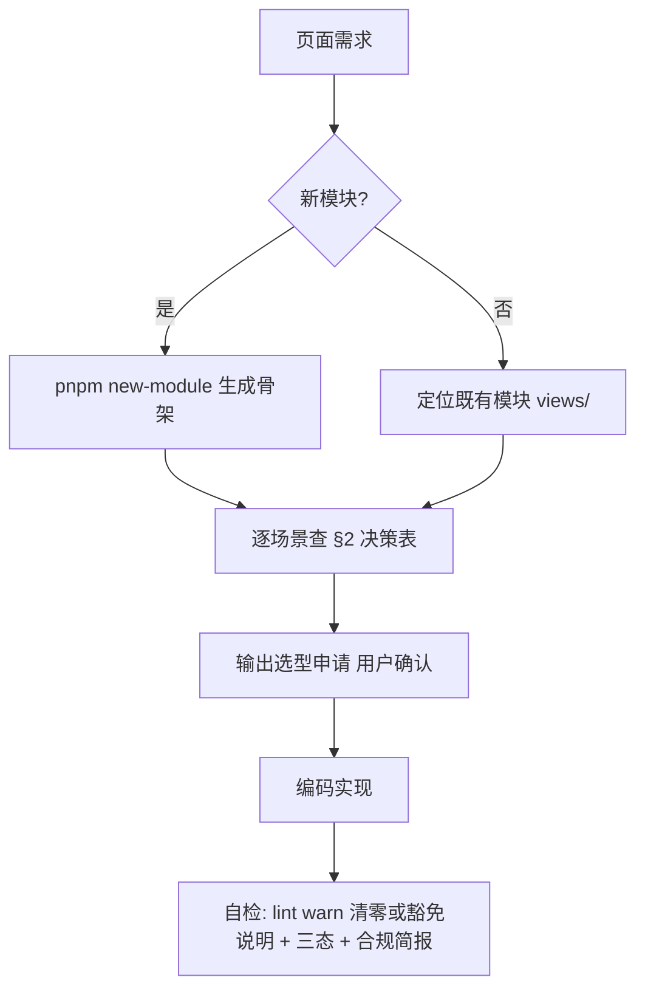

# 页面开发组件选型速查

> **TL;DR**：在任意 app 新增/修改页面前，先走 §2 决策表逐场景选型（封装组件优先），
> 用 §4 选型申请模板向 AI 提需求；§3 是豁免清单，§5 是交付自检。配套 warn 级 ESLint
> 规则 `local/prefer-wrapped-component`（eslint.config.mjs）让漂移可见。

## 1. 为什么会有这篇文档

本仓库的公共能力集中在 `packages/ui`（ProTable / XForm / ProDialog / BaseChart /
RichTextEditor / AsyncState 等）与 `packages/shared`（useAppRouter / useRequest /
useAuth / useDict 等）。AI 代理（以及新加入的开发者）在不熟悉资产清单时，容易
退回 Element Plus 原始组件把已封装的能力再实现一遍（裸拼 `el-table`、手写
`ElMessageBox.confirm` 等）。负面清单（AGENTS.md「业务代码强制封装」）只拦
住了 axios / useRouter 两条；本篇是**正面清单**：每个常见场景直接给出首选封装、
样板文件与使用指南，让"正确姿势"成为默认路径。

## 2. 场景 → 组件选型决策表（核心）

> 用法：实现页面前逐场景对号。某一格"避免"列的写法出现在新代码里且无 §3 豁免理由，
> 即视为选型违规（lint warn + review 打回）。

| 场景                                  | ✅ 首选（封装）                                                                        | ❌ 避免（原始写法）                                           | 样板参考                                                                | 使用指南            |
| ------------------------------------- | -------------------------------------------------------------------------------------- | ------------------------------------------------------------- | ----------------------------------------------------------------------- | ------------------- |
| 新模块 / 新页面骨架                   | `pnpm new-module <kebab-name>` 脚手架（自动产出 views/api/store/locales 骨架）         | 手写全套目录与菜单接线                                        | `scripts/new-module.ts`                                                 | docs/08 §模块化架构 |
| 列表页（表格 + 搜索 + 分页 + 工具栏） | `<ProTable>`（schema 驱动列配置 + 搜索表单 + 分页内置）                                | 裸拼 `<el-table>` + 手写 el-pagination / el-form 搜索区       | `apps/docs/src/modules/demo/examples/ProTable/ProTableSearchFilter.vue` | docs/29             |
| 表单页（含校验 / 联动 / 弹窗表单）    | `<XForm>`（schema 驱动；弹窗表单用 `ProDialogForm`）                                   | 手写 `<el-form>` 逐字段堆 el-form-item + rules                | `apps/docs/src/modules/demo/examples/XForm/XFormBase.vue`               | docs/24、docs/31    |
| 命令式弹窗（页面内打开对话框）        | `useDialog()`（promise 化，取消 reject `DialogCancelledError`）                        | 手写 `<el-dialog>` + 响应式 visible 状态往返                  | `apps/docs/src/modules/demo/examples/ProDialog/ProDialogUseDialog.vue`  | docs/27、docs/32    |
| 二次确认（删除 / 危险操作）           | `useConfirm()`（取消 resolve `false`，无需 try/catch）                                 | 裸调 `ElMessageBox.confirm / alert / prompt`                  | `apps/docs/src/modules/demo/examples/ProDialog/ProDialogUseDialog.vue`  | docs/32             |
| 图表                                  | `<BaseChart>`（统一主题 / resize / loading 封装）                                      | 直接引 echarts 手写 init / dispose                            | docs/28 §示例索引（demo 站点 BaseChart 演示）                           | docs/28             |
| 富文本                                | `<RichTextEditor>`（内置 sanitize，XForm 有专属节点）                                  | 直接集成 wangEditor / 裸 v-html                               | docs/30 §示例                                                           | docs/30             |
| 网络请求                              | `useRequest`（Loading / Error / Empty 三态）                                           | 直接 import axios / 裸 fetch                                  | docs/17 §3                                                              | docs/17             |
| 路由跳转 / 参数 / back                | `useAppRouter`                                                                         | `import { useRouter } from 'vue-router'`（ESLint error 已拦） | docs/07 § guards 消费                                                   | docs/07             |
| 权限判断                              | `useAuth`（`hasPerm` / `hasAnyPerm`）                                                  | 手写角色字符串比对                                            | docs/23 §前端消费                                                       | docs/23             |
| 字典翻译 / 下拉选项                   | `useDict`（5min TTL + Promise 防抖池）                                                 | 手写接口 + 本地 ref 缓存                                      | docs/11 §组合式用法                                                     | docs/11             |
| 异步组件渲染三态                      | `<AsyncState>` 包渲染 + `useRequest` 包数据                                            | `v-if="loading"` / 空 `return null`                           | docs/47 排障样例                                                        | docs/10             |
| 页面级状态                            | 组件内 `ref` / computed；确需共享 → 模块私有 `modules/<m>/store/`（Pinia Setup Store） | 一上来就塞进全局 `store/modules`                              | docs/19 §分层                                                           | docs/19             |

选型决策流程：



## 3. 合法例外（豁免场景）

以下场景直接使用原始组件**不构成违规**——`local/prefer-wrapped-component`
warn 规则对这些路径不做提示：

| 豁免路径 / 场景                    | 理由                                   |
| ---------------------------------- | -------------------------------------- |
| `apps/docs/src/modules/demo/**`    | 教学 demo 有意用原始写法做对照演示     |
| `packages/ui/**`                   | 封装组件的内部实现本身必须基于原始组件 |
| `**/*.spec.*` / `**/test-utils/**` | 测试桩与测试工具，选型约束只管生产代码 |
| docs/47 排障 / 最小复现            | 故意剥离封装层定位问题                 |

不在上表内的例外须在选型申请中写明理由（如"该交互封装组件不支持 xxx"）。

## 4. 向 AI 提需求的正确姿势（选型申请工序）

给 AI 下"加页面"类需求时，先让它输出选型说明、确认后再写代码——把违规拦截
从事后 review 前移到事前：

```markdown
【组件选型申请】<页面名>

- 页面类型：列表页 / 表单页 / 详情页 / Dashboard / 混合
- 逐场景选型（对照 docs/50 §2）：
  - 场景1 → 选用 <组件名>（@vv/ui ……）→ 理由一句话
  - 场景2 → 不用封装，理由：<……>（须落在 §3 豁免内或说明能力缺口）
- 接口接入：<api 文件路径>，经 useRequest
- 状态归属：<组件内 ref / 模块 store / 全局 store> + 一句理由

以上确认后我再开始编码。
```

AI（或人类开发者）答复模板要点：每个 UI 场景必须有"首选封装 / 豁免理由"二选
一；回答不了"为什么不用 ProTable"的列表页需求直接打回。

## 5. 交付自检清单

页面需求完成后，随合规简报一并输出：

- [ ] `pnpm lint` 对改动文件无新增 `local/prefer-wrapped-component` warn；若有，
      逐条说明落在 §3 豁免内
- [ ] 新代码所有异步数据流有 Loading / Error / Empty 三态
- [ ] 合规简报附一行「组件选型符合度：全部走封装 / N 处例外（理由见选型申请）」
- [ ] 存量坏先例未扩散：未在新增代码中复制已存在的原始组件实现模式

> 存量说明：部分既有页面（如 admin 早期视图与 auth 登录表单）存在原始组件重复实现，
> 属历史债。新增代码**不得**以它们为样板；以本文档 §2 样板列为准。渐进改造另行立项，
> 不做顺手清理。存量债文件集中豁免于 eslint.config.mjs 的
> `app/prefer-wrapped-component-legacy-exempt` block（因 lint 脚本 `--max-warnings 0`，
> warn 即阻断）；改造立项时须同步移除对应豁免行。
