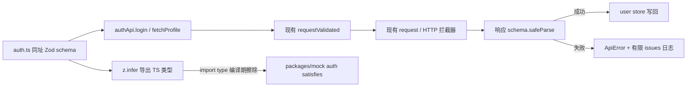

# API 契约单源设计：auth 响应 Schema 试点

> 日期：2026-10-27  
> 基线：`feature/monorepo-node-gateway@58ca86f`  
> 状态：设计已批准落盘，待复核后进入实施计划  
> 批次：P1，在共享包依赖契约完成后实施

## 1. 背景与问题证据

项目已经具备三类契约能力，但尚未形成一条生产闭环：

1. `packages/shared/src/api/validator.ts:60-65` 提供 `requestValidated(schema, config)`，可在响应后返回 `z.infer` 类型；全仓检索仅发现文档、定义与 spec，没有生产调用方。
2. `packages/shared/src/api/modules/auth.ts` 使用手写 TS interface 声明 `LoginResult`、`UserProfile`，只能提供编译期约束。
3. `packages/mock/src/auth.ts:3-5` 已通过 `import type` 与 shared 类型挂钩，说明 mock 可以继续保持零运行时 shared 依赖。
4. 菜单契约同时维护 `RemoteMenuItem` interface 与 admin 侧递归 Zod schema，证明“类型与运行时校验分离”会产生重复；但菜单具有部分非法项跳过的特殊语义，不适合作为首个试点。

选择 auth 的原因是响应结构简单、无递归、现有 mock 已绑定类型，并且能在不大改调用方的情况下验证完整链路。

## 2. 目标与非目标

### 2.1 目标

- 让 `LoginResult`、`UserProfile` 的 TS 类型从同址 Zod schema 推导。
- 让 `login` 与 `fetchProfile` 复用现有 `requestValidated`，在 API 边界识别响应漂移。
- 保持 mock 的 `import type` 形态，避免把 Zod 运行时带入 mock bundle。
- 保持 httpOnly cookie、401/refresh、`silent`、store 调用顺序和现有用户反馈语义。
- 为后续其他接口建立可复制的最小模式，而非一次性全量改造。

### 2.2 非目标

- 不改登录凭证、Session 标记、权限计算或开放重定向防护。
- 不把所有 `request<T>` 强制替换为 `requestValidated`。
- 不迁移菜单递归 schema，不改变其“整体失败后逐项保留合法项”的容错策略。
- 不引入代码生成、OpenAPI、RPC 或新的契约框架。
- 不在本批实施响应 unknown 字段严格拒绝；先保持现有前向兼容行为。

## 3. 方案比较与选择

| 方案 | 优点 | 缺点 | 结论 |
| --- | --- | --- | --- |
| A. 仅保留 TS interface | 无运行时成本 | 无法发现真实响应与类型漂移 | 不满足目标 |
| B. schema 与 API 同址，类型推导，按接口接入（本方案） | 单一契约、渐进接入、复用现有工具 | 简单对象校验产生少量运行时成本 | 推荐 |
| C. 全接口统一强制 schema | 一致性最高 | 容错、性能、错误语义和迁移成本过大 | 不做 |

## 4. 目标数据流

关键约束：mock 只消费类型；schema 的运行时 import 只存在浏览器 API 链路。

## 5. 详细设计

### 5.1 Schema 与类型同址

在 `packages/shared/src/api/modules/auth.ts` 声明：

- `loginResultSchema`：校验 `{ profile: { id: number, name: string } }`。
- `userProfileSchema`：校验 `{ id: number, name: string, permissions: string[] }`。
- `LoginResult = z.infer<typeof loginResultSchema>`。
- `UserProfile = z.infer<typeof userProfileSchema>`。
- `LoginPayload` 保持现有 interface，本批只验证响应，不扩大为请求体改造。

所有响应对象 schema 使用 `.passthrough()`，包括嵌套 `profile`：

- Zod 默认对象 parse 会裁剪未知键；直接替换会改变当前运行时数据形状。
- 首批目标是“增加必需字段校验而不丢弃后端新增字段”，因此显式保留 unknown 字段。
- 是否改为严格拒绝属于独立的 API 版本策略，不在本批决定。
- 已知类型形态差异：`.passthrough()` 使 `z.infer` 产出带 catchall 的宽松类型（而非原 interface 的封闭形状）；现有消费方（mock `satisfies`、user store `ref<UserProfile | null>`、根 barrel `export type`）均为类型位置消费，实测兼容。消费方只允许依赖 schema 声明的字段，catchall 字段不作为公共契约使用。
- 写法与存量保持一致：`apps/admin/src/router/remote.ts` 的递归菜单 schema 已使用 `.passthrough()`（zod v4 可用）。

schema 可以经 deep path 供测试使用；shared 根 barrel 继续只导出纯类型，不为所有 `@vv/shared` 消费方增加 Zod 运行时入口。

### 5.2 API 接线

- `authApi.login`：用 `requestValidated(loginResultSchema, config)` 替换同参数 `request<LoginResult>(config)`。
- `authApi.fetchProfile`：用 `requestValidated(userProfileSchema, config)` 替换同参数 `request<UserProfile>(config)`。
- `silent: options?.silent` 原样透传，url/method/data 不变。
- `logout` 保持 `request<void>`，不为空响应制造无意义 schema。
- `packages/shared/package.json` 增加 `zod: catalog:` peer 依赖；依赖声明工作按 P0 规则验收。

### 5.3 mock 与 barrel

- `packages/mock/src/auth.ts` 保持 `import type { LoginResult, UserProfile } from '@vv/shared'` 和 `satisfies`。
- 类型推导改变后，mock 字段缺失或类型错误仍由 `type-check` 暴露。
- shared 根 barrel 使用带 JSDoc 的纯类型 re-export，不新增 schema 的运行时 re-export，遵守现有 IDE hover 约束。
- 不让 mock 在运行时 import schema，避免破坏 vite-plugin-mock 的 bundle 边界。

### 5.4 错误与状态语义

| 场景 | 设计行为 |
| --- | --- |
| 网络错误、HTTP/业务码错误 | 继续由现有 `request` 与拦截器处理，不改写 |
| 成功响应缺少必需字段或字段类型错误 | `requestValidated` 抛出 `ApiError(code=500)`，日志只输出最多 3 条 issues，不打印完整响应 |
| 响应含额外字段 | `.passthrough()` 保留，不作为错误 |
| `fetchProfile({ silent: true })` | `silent` 继续传给 HTTP 层；schema 错误沿用 validator 现有的“不主动 toast”行为 |
| login 响应校验失败 | `await authApi.login` 在 `Session.set` 之前抛错，不写入登录标记 |
| login 成功但后续 fetchProfile 失败 | 保持 user store 现有调用顺序，本批不夹带登录状态事务重构 |

schema 校验失败不记录密码、cookie 或完整 profile 响应。实现完成后必须经过安全审查，确认日志与错误反馈没有泄露敏感信息或形成重复提示。

## 6. 文件变更清单（实施计划输入）

| 类型 | 路径 | 变更目的 |
| --- | --- | --- |
| 修改 | `packages/shared/src/api/modules/auth.ts` | schema、类型推导、两个 API 接入 |
| 新增 | `packages/shared/src/api/modules/auth.spec.ts` | schema 与 API 边界测试 |
| 修改 | `packages/shared/src/store/modules/user.spec.ts` | 仅在需要补充 login 状态顺序回归时修改，不重写既有 mock 体系 |
| 修改 | `packages/shared/src/index.ts` | 保持纯类型 barrel 与 JSDoc |
| 修改 | `packages/shared/package.json` | 声明 Zod peer 依赖 |
| 核对/必要注释更新 | `packages/mock/src/auth.ts` | 保持类型挂钩和 bundle 边界，不引入运行时 schema |
| 修改 | `docs/14-zod请求参数校验使用规范.md`、`CHANGELOG.md` | 将“只有示例”更新为真实 auth 用法及错误语义 |
| 明确不改 | `apps/admin/src/router/remote.ts` | 菜单容错与递归 schema 留待独立评估 |

## 7. 测试设计

### 7.1 单元与集成测试

采用 AAA 结构，至少覆盖：

1. 合法 `LoginResult` / `UserProfile` 能通过并保留额外字段。
2. 缺少 `profile`、`permissions`，或 `id`/`name` 类型错误时拒绝。
3. `login` 的 url/method/data 原样透传，合法结果类型正确。
4. `fetchProfile({ silent: true })` 的 `silent` 原样透传。
5. 非法响应转成 `ApiError`，日志不包含完整响应、密码或 cookie。
6. 既有 user store spec 全部通过；若补充 login 失败测试，必须在 HTTP/schema 层 mock，而不是把 `authApi` 整体 mock 掉后声称覆盖 schema。
7. `packages/mock` 类型检查通过，证明 `satisfies` 仍约束推导后的类型。

### 7.2 浏览器与安全验证

1. 经 `pnpm dev:gateway admin auth` 完成正确账号登录、错误账号登录、登出。
2. 检查 cookie 设置、Session 标记和 profile 权限展示与基线一致。
3. 通过受控 mock 返回缺失 `permissions` 的 profile，确认出现可诊断错误且不会写入损坏权限状态。
4. portal 匿名 `silent` 探测不出现额外 toast/网络横幅。
5. 模拟 401/refresh 流程，确认 schema 改造未改变既有认证链路。
6. 实施后进行独立安全审查和代码审查；auth 流程不以“单测通过”替代浏览器验收。

## 8. 回退策略

本批只修改 auth API、对应测试、类型导出和文档。若出现兼容问题，可整体恢复 `auth.ts` 的 interface + `request<T>` 形式并移除 Zod peer；mock、store 和 app 页面无需分别回退。若问题仅来自 unknown 字段策略，优先保留实现并确认 `.passthrough()` 是否完整覆盖嵌套对象，而不是放松必需字段校验。

## 9. 完成定义与后续扩展门槛

P1 仅在 auth 两个接口的 schema、运行时校验、mock 类型、错误语义和真实登录流程全部验收后完成。

扩展其他接口前必须逐项确认：

- 是否允许整包失败，还是需要菜单式部分容错。
- 是否存在分页、递归、日期转换或 unknown 字段兼容要求。
- 是否会引入新的运行时依赖或改变全局错误反馈。
- 是否有对应 mock 类型和非法响应测试。

不满足这些条件时，不为追求“统一”而批量替换其他 API。
