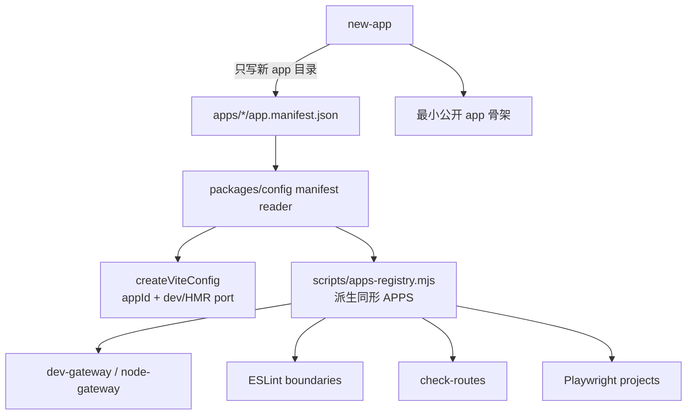

# 应用 Manifest 与 New-App 脚手架设计

> 日期：2026-10-27  
> 基线：`feature/monorepo-node-gateway@58ca86f`  
> 状态：设计已批准落盘，待复核后进入实施计划  
> 批次：P2，在共享包自包含与 auth 契约试点之后实施

## 1. 背景与问题证据

当前 `scripts/apps-registry.mjs` 已将 dev-gateway、node gateway、Playwright、ESLint 和路由检查的应用名单/端口收敛到一处，但新增 app 仍有两类重复：

1. `docs/43-Monorepo结构与开发指引.md:70-76` 要求手工创建工程、env、Vite 配置并登记端口。
2. 端口同时存在于 `apps/<a>/vite.config.ts` 的 `portOffset` 和注册表的绝对 `port`，只能由 `check-routes` 事后锁死。
3. 注册表条目是手写 `.mjs`，类型形状另由 `.d.mts` 镜像；新 app 还需要理解多个消费方才敢修改。
4. `build-pages` 等目录自发现机制已经证明：只要元数据完整，很多消费方无需逐 app 修改。

本设计不是推翻注册表，而是把注册表从“手写列表”升级为“从 app 本地 manifest 派生的视图”，同时保持 `APPS` 对现有消费方的形状和顺序。

## 2. 目标与非目标

### 2.1 目标

- 每个 app 的 `name/port/requiredRoutes` 只在自己的 manifest 中维护一次。
- Vite dev 端口与所有注册表消费方读取同一份数据，删除端口双写及对应正则校验。
- 保持 `APPS` 的字段形状与当前端口升序，避免 dev-gateway、E2E 和根重定向行为漂移。
- 提供 `new-app`，生成可 dev/build/test 的最小公开应用，而不是只生成一半骨架。
- 新 app 生成过程只写新目录，不改 CI、deploy、网关或根 dev 脚本。

### 2.2 非目标

- 不重写 `check-routes` 的模块路由/白名单正则分析，不把路由 AST 化混入本批。
- 不把 `base/rootRedirect/title/authOrigin` 等未证明有多方消费的字段塞入 manifest。
- 不提供受保护 admin 模板、远程菜单模板、`remove-app` 或 app 发布能力。
- 不删除现有 6 个根 `dev:<app>` 便捷命令；新 app 统一使用 `pnpm -C apps/<name> dev`。
- 不让生成器自动执行 `pnpm install`、git commit、push 或部署。

## 3. 方案比较与选择

| 方案 | 优点 | 缺点 | 结论 |
| --- | --- | --- | --- |
| A. 保留中心注册表，只加 new-app | 实现较少 | 端口和条目仍需双写，运行期漂移问题未根治 | 不完整 |
| B. app 本地 JSON manifest + 同步派生 APPS（本方案） | Node/ESLint/Vite 均可同步读取；类型与数据边界清晰；易回退 | 需要新增读取/校验层并迁移 6 个 app | 推荐 |
| C. 每 app ESM/TS 配置动态 import | 可写复杂逻辑和注释 | ESLint 同步加载、TS strip-types 差异和发现顺序更复杂 | 不做 |

## 4. 目标架构



`APPS` 仍是所有现有消费方的公共入口；变化只发生在它的数据生产方式。

## 5. Manifest 契约

### 5.1 文件与字段

每个 app 新增 `apps/<name>/app.manifest.json`，首批只允许三个业务字段：

```json
{
  "name": "admin",
  "port": 5174,
  "requiredRoutes": ["Forbidden", "NotFound", "ServerError"]
}
```

- `name`：kebab-case，必须等于 app 目录名；对应包名 `@vv-app/<name>`。
- `port`：有效 TCP 端口号，全 workspace 唯一，不得与网关 8080 冲突。
- `requiredRoutes`：非空、去重的路由 name 数组，必须包含 `NotFound`；语义与当前 B/C 校验一致。

JSON 不承载注释，字段说明和示例统一放 docs/43，避免再引入 JSONC 解析依赖。

### 5.2 读取器位置与形态

在 `packages/config/src/` 新增：

- `app-manifest.mjs`：纯 Node ESM，提供 `readAppManifest(appRoot)` 与 `discoverAppManifests(appsRoot)`。
- `app-manifest.d.mts`：声明 `AppManifest` 和两个函数的类型。
- 对应 Vitest spec：使用临时目录，不读写真实 apps。

选择 `.mjs` 是因为 `eslint.config.mjs` 不经 `--experimental-strip-types`；该约束与现注册表一致。`packages/config` 只处理通用元数据，不 import 任何 app 源码，不构成包到 app 的代码依赖。

`scripts/apps-registry.d.mts` 改为复用 `AppManifest` 类型，不再重复声明字段形状；既有 `RegistryAppEntry` 可保留为类型别名以减少消费方改动。

### 5.3 发现、排序与错误

`discoverAppManifests` 的契约：

1. 只读取含 `app.manifest.json` 的直接子目录，不递归扫描。
2. 按 `port` 数值升序返回，刚好保持当前 `admin/docs/portal/h5/big/auth` 顺序，不新增 `order` 字段。
3. 对 JSON 语法错误、字段类型错误、目录/name 不一致、重复 name/port、缺失 `NotFound` 给出包含文件路径的明确错误。
4. 不在缺省情况下回退到 5174，避免多个 app 静默抢同一端口。
5. `check-routes` 继续独立扫描 `apps/*`，报告“有 app 骨架但缺 manifest”及“manifest 指向不存在/不完整骨架”，保留原 E 类防静默失效目标。

## 6. Vite 与注册表改造

### 6.1 createViteConfig

- 保留 `appRoot`、`base/mockPath/h5Rem/extraPlugins/componentResolvers` 等现有扩展参数。
- 工厂内部调用 `readAppManifest(appRoot)`，以 `manifest.name` 注入 `VITE_APP_ID`，以 `manifest.port` 设置 dev/HMR 端口。
- 6 个调用点同批迁移后，从 `AppViteOptions` 删除 `appName` 与 `portOffset`，不保留会形成第二事实源的兼容回退。
- 缺失或非法 manifest 直接 fail fast，错误中给出期望文件路径。

### 6.2 apps-registry 与 check-routes

- `scripts/apps-registry.mjs` 改为 `export const APPS = discoverAppManifests(<repo>/apps)`。
- `APPS` 元素仍含 `name/port/requiredRoutes`，故以下消费方不需要改业务逻辑：
  - `scripts/dev-gateway.ts`
  - `scripts/node-gateway.ts` 及其 spec
  - `playwright.config.ts`
  - `eslint.config.mjs`
- `scripts/check-routes.ts` 删除 `portOffset` 正则和“端口双写锁死”，替换为 manifest 完整性、目录一致性、端口唯一性和 `package.json.name` 校验。
- 路由 A-D 检查与豁免规则原样保留，避免本批同时改变公开路由语义。

## 7. New-App 生成器

### 7.1 命令与安全边界

新增根命令：`pnpm new-app <kebab-name>`。

执行顺序：

1. 校验名称、目标目录不存在、manifest 合法且可分配端口。
2. 默认端口为现有最大 app 端口 + 1，并再次检查唯一性及 8080 冲突。
3. 所有预检通过后才开始写入；若目录已存在，不覆盖任何文件。
4. 只写 `apps/<name>/` 新目录，不修改其他 app、根 scripts、CI 或注册表文件。
5. 输出后续命令：`pnpm install`、`pnpm -C apps/<name> dev`、`pnpm check:routes`。

### 7.2 模板定位

首版只提供**最小公开应用**：

- 一个公开 `Home` 首页和一个公开 `NotFound`，无业务数据、无远程菜单、无权限假设。
- `rootRedirect` 为 `/home`；`requiredRoutes` 只声明系统路由 `NotFound`，公开 Home 由 app 白名单吸收。
- 使用现有 `bootstrapApp`、`createAppRouter`、`AppShell`、shared store/plugins 和 UI 全局组件，不复制一套新装配方式。
- 默认使用 factory/env 兜底，不要求为了启动立即创建 `.env`。
- 生成 `package.json/index.html/env.d.ts/tsconfig*.json/uno.config.ts/vite.config.ts/vitest.config.ts` 与最小 `src` 骨架，保证可独立 dev/build/test。
- 受保护应用模板不属于首版；不得把公开模板悄悄描述成可直接承载敏感业务的完整模板。

模板放 `scripts/templates/app/`，CLI 与模板渲染/校验逻辑拆分，避免单文件超过行限。模板文件中的 `__APP_NAME__`、`__APP_PORT__` 等占位符只在生成时替换，设计文档自身不保留未决占位需求。

### 7.3 测试

- 参数非法、目录已存在、端口冲突时不写文件。
- 在临时目录生成后，manifest 可读取，占位符全部替换，必需文件齐全。
- 生成结果的 package name、app name、端口、root route、白名单和 requiredRoutes 一致。
- 原 6 个 app 的 manifest 迁移测试证明 `APPS` 名称与顺序不变。
- 实现验收时生成一次 `apps/scaffold-smoke`，实际运行 dev/build/test/check-routes 后，仅删除本任务新建的 smoke 目录完成回退；该临时 app 不进入最终变更集。

## 8. 文件变更清单（实施计划输入）

| 类型 | 路径 | 变更目的 |
| --- | --- | --- |
| 新增 | `apps/{admin,auth,big,docs,h5,portal}/app.manifest.json` | 6 个 app 元数据单源 |
| 新增 | `packages/config/src/app-manifest.{mjs,d.mts}` 与 spec | 同步读取、校验、发现、排序 |
| 修改 | `packages/config/src/create-vite-config.ts` | 从 manifest 派生 appId 与端口 |
| 修改 | `apps/*/vite.config.ts` | 删除 `appName/portOffset` 双写 |
| 修改 | `scripts/apps-registry.mjs`、`scripts/apps-registry.d.mts` | 派生 APPS、复用统一类型 |
| 修改 | `scripts/check-routes.ts` 及相关 spec | 删除端口双写正则，增加 manifest/目录契约校验 |
| 新增 | `scripts/new-app.ts`、拆分后的生成逻辑与 spec | CLI、预检、临时目录测试 |
| 新增 | `scripts/templates/app/**` | 最小公开 app 模板 |
| 修改 | 根 `package.json` | 仅增加 `new-app` 入口 |
| 修改 | `docs/43-Monorepo结构与开发指引.md`、`README.md`、`CHANGELOG.md` | 更新新增应用流程和排障口径 |
| 原则上不改 | dev/node gateway、Playwright、ESLint 边界业务逻辑、build-pages/build-prod | 依靠同形 APPS 与目录自发现保持兼容 |

## 9. 验证与回退

### 9.1 自动验证

- manifest reader 全部边界 spec、new-app 临时目录 spec。
- `pnpm check:routes`：确认 A-E 语义与 manifest 新校验通过。
- `pnpm test:gateway`：HTTP/WS/302/502 行为不回归。
- `pnpm lint`、`pnpm type-check`、`pnpm test`、`pnpm build`。
- Playwright project 名称、baseURL、webServer command 与迁移前一致。
- `pnpm build:pages` 与 `pnpm build:prod` 至少验证 app 发现和 base 注入未受影响。

### 9.2 人工验证

1. `pnpm dev:gateway` 的启动顺序、完整根 302、各 app 端口与迁移前一致。
2. `pnpm dev:gateway admin auth` 子集顺序与根 302 不变。
3. 修改某一 app 端口只改 manifest，dev/HMR、网关、E2E 和检查脚本同时生效。
4. 临时 smoke app 从一条命令完成生成、安装链接、dev/build/test；验证后按新建清单删除。

### 9.3 回退策略

- 既有 6 app manifest 迁移与 new-app 生成功能分别形成独立变更集。
- 注册表迁移回退时恢复中心列表、`appName/portOffset` 和旧 check-routes；不涉及业务模块。
- new-app 本身只新增脚本和模板；其生成物只写新目录，删除对应新建 smoke 目录即可，不覆盖用户既有文件。

## 10. 完成定义

- `name/port/requiredRoutes` 不再存在第二份手写数据，端口不再依赖双写一致检查。
- `APPS` 形状、端口升序及所有现有消费方行为保持兼容。
- `new-app` 能生成真正可运行的最小公开 app，而非仍需手工补多个关键文件的半骨架。
- 路由检查职责没有借机扩张，未引入受保护模板、remove-app、自动安装或 Git 副作用。
- 文档、CHANGELOG、自动测试和真实 smoke 证据齐全。
