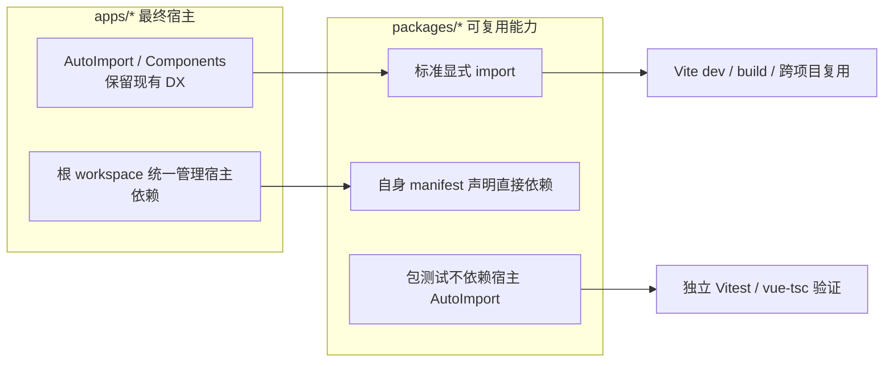

# 共享包自包含与依赖契约设计

> 日期：2026-10-27  
> 基线：`feature/monorepo-node-gateway@58ca86f`  
> 状态：设计已批准落盘，待复核后进入实施计划  
> 批次：P0，先于 API 契约单源与应用 manifest 改造实施

## 1. 背景与问题证据

当前 `@vv/shared` 是源码直链包，但“可 import”不等于“可独立运行”。包内部分源码依赖宿主 Vite 的 `unplugin-auto-import` 在转换期补齐自由变量，形成以下耦合链：

1. `packages/shared/src/types/auto-globals.d.ts:4-12` 说明包独立类型检查依赖手工全局声明；`:18-27` 声明 `ref/computed/defineStore/ElMessage` 等标识符。
2. `packages/shared/vitest.config.ts:10-12` 明确缺少 AutoImport 会产生 `ReferenceError`，`:20-25` 因而装配另一份注入配置。
3. `packages/config/src/create-vite-config.ts:243-250` 为避免预构建绕过 AutoImport，维护 `optimizeDeps.exclude` 特殊清单。
4. `packages/shared/README.md:6-10` 将宿主装配列为运行时生死线，换宿主需要人工复刻。
5. 静态复核发现 `composables/store/directives/api` 均有注入式调用；`api/http.ts` 还通过 `ElMessage.error` 依赖注入。文件数量必须以实施前的全量扫描为准，不能把早期局部扫描的“11 个文件”当成硬编码验收数字。
6. 包依赖声明也存在缺口：`@vv/config` 直接使用 `unocss/vite` 与 `vite`，`@vv/ui` 直接使用 `vue-i18n` 与 `@element-plus/icons-vue`，对应 `package.json` 未完整声明。

这使共享包的测试、类型检查、dev 预构建和跨项目复用都依赖隐式宿主知识，也增加了冷启动与新人排障成本。

## 2. 目标与非目标

### 2.1 目标

- 建立明确边界：**应用层可以使用 AutoImport 提升 DX，可复用包的生产源码不得依赖它才能运行**。
- 先让纯 TS 的 `@vv/shared` 在无 AutoImport 的 Vitest 环境下独立通过测试。
- 让 `packages/*` 的直接依赖在自身 manifest 中可见，并机械阻止包间反向依赖。
- 保留 `apps/*` 现有 AutoImport 写法、组件自动注册和开发体验。
- 将 Element Plus 消息样式等副作用依赖纳入迁移，避免只修类型、不修运行表现。

### 2.2 非目标

- 不引入 dist 构建、npm 发布、版本发布策略或新的包管理器。
- 本批不迁移 `@vv/ui` 的组件自动导入、全局组件注册和 SCSS 宿主装配。
- 不承诺包脱离 Vite：`import.meta.env`、`@vv/shared/app-styles` 的 `virtual:uno.css` 与别名仍属明确的 Vite 宿主入口。
- 不在本批删除或改写 `optimizeDeps.exclude`；它只能在后续真实 dev 验证后单独收尾。
- 不把根 workspace 对 app 宿主依赖的统一管理改为全量 app 依赖治理。本批机械检查聚焦可复用的 `packages/*`。

## 3. 方案比较与选择

| 方案 | 优点 | 缺点 | 结论 |
| --- | --- | --- | --- |
| A. 仅补文档和宿主装配插件 | 改动最小 | 自由变量、重复注入配置和预构建限制继续存在 | 不推荐 |
| B. app 保留隐式注入，packages 逐步显式化（本方案） | 同时保留业务 DX 与包可移植性；可分批回退 | 需要调整项目约定并核对副作用 import | 推荐 |
| C. 全部显式化并立即构建发布包 | 最彻底 | 改动面大、引入 dist/发布复杂度，当前无发布需求 | 不做 |

## 4. 目标架构

核心原则是“隐式注入只停留在最终宿主，不穿过包边界成为运行时必须条件”。

## 5. 详细设计

### 5.1 生产源码显式导入

实施前先按 `auto-globals.d.ts` 中的 9 个标识符重新生成精确清单，并区分代码、注释和已有显式 import。当前复核范围至少包括：

- `packages/shared/src/composables/`：`useRequest`、`useDict`、`useAuth`、`useAppRouter`、`useTheme`。
- `packages/shared/src/store/modules/`：`app`、`user`、`dict`、`theme`。
- `packages/shared/src/directives/`：`auth`、`permission`。
- `packages/shared/src/api/http.ts`。
- `packages/shared/src/directives/copy.ts` 已有 `ElMessage` 显式 import，只需纳入样式一致性核对。

迁移规则：

1. 值导入与类型导入分开，优先复用现有 `import type`，不改运行逻辑和公开签名。
2. Vue、Pinia、Vue Router API 从原包显式导入，不再依赖 `declare global` 获得类型。
3. 不做“顺手重构”、不改文件名、不改函数行为；测试 mock 说明符保持与 SUT 的真实 import 一致。
4. app 侧 AutoImport 清单本批不删减，避免把包迁移扩张成 app 写法迁移。

### 5.2 Element Plus 消息与样式

`useAppRouter.ts`、`api/http.ts` 的 `ElMessage` 改为显式 import；`directives/copy.ts` 已采用该形式。三个消费入口都显式引入对应 Message 样式：

- 逻辑 import：`element-plus`。
- 样式 import：`element-plus/es/components/message/style/css`。

原因：显式 import 不再经过 AutoImport 的 `importStyle` 注入，只改 JS 会导致提示样式依赖其他组件碰巧带入。样式 import 是声明式副作用，构建工具会去重，不额外抽象消息适配层。

现有 `typeof ElMessage !== 'undefined'` 分支在显式 import 后不再承担“宿主可能未注入”的语义。保留或简化必须由对应 spec 证明行为一致，不得借迁移改变路由错误和登出错误反馈。

### 5.3 类型声明与下游 tsconfig

- 删除 shared `auto-globals.d.ts` 中所有运行时值的全局声明。
- 将仍需要的 `pinia-plugin-persistedstate` 模块增强独立为 `packages/shared/src/types/persistence-types.d.ts`，避免继续沿用名不副实的 `auto-globals` 文件名。
- 同步更新两个显式包含旧文件的下游配置：
  - `packages/ui/tsconfig.json`
  - `packages/mock/tsconfig.json`
- `@vv/ui/src/types/auto-globals.d.ts` 本批保留；UI 自身仍按原方式工作。
- CHANGELOG 中旧文件名的历史记录不改写，只在本次变更记录说明新形态。

### 5.4 shared Vitest 去宿主化

`packages/shared/vitest.config.ts` 移除：

- `unplugin-auto-import/vite` 插件实例；
- `ElementPlusResolver`；
- 仅为注入全局而存在的 import 与注释。

保留 `jsdom`、`globals`、包根路径和既有 exclude。测试通过即证明 shared 测试运行不再需要 AutoImport；若出现自由变量，必须补真实源码 import，不得回退插件或增加测试专用全局补丁。

### 5.5 packages manifest 契约

按实际 import 审计并补齐，而不是照抄根 `package.json`：

- `@vv/config`：补充 `vite`、`vitest`、`unocss` 等公开工厂直接消费的宿主依赖；默认启用的图标集合也需在宿主安装契约中明确。
- `@vv/ui`：补充 `vue-i18n`、`@element-plus/icons-vue`。
- `@vv/shared`：补齐审计发现的直接依赖，例如 `app-styles.ts` 使用的 `normalize.css`；Zod 不在本批凭空加入，P1 产生真实运行时消费时再添加。
- 可复用库的运行时依赖继续遵循 `peerDependencies + catalog`；`@vv/*` 内部运行依赖使用 `workspace:*`。测试/配置专用依赖归 `devDependencies`。

### 5.6 机械检查

新增本地 ESLint rule（不引入新 npm 包），复用现有 TS/Vue 解析管线，检查 `packages/**/*.{ts,mts,tsx,vue}`：

1. 静态 import、literal dynamic import、re-export 的包名是否在当前包的 `dependencies/peerDependencies` 中声明；spec 与配置文件允许 `devDependencies`。
2. `@vv/*` 依赖方向仅允许：
   - `mock → shared`
   - `ui → shared`
   - `config` 不依赖其他 `@vv/*` 包
   - `shared` 不依赖其他 `@vv/*` 包
3. 既有 `packages/** → apps/**` 与 UI 子系统边界规则继续保留，不重复实现。
4. 相对路径、Node builtins、`virtual:*` 和项目既定别名不按 npm 包处理；非字面量动态 import 不做猜测性判断。

检查只保证“显式模块说明符有声明、包方向正确”，不声称能推导 AutoImport/Components 隐式依赖；这些宿主依赖由 manifest 审计和文档兜底。

### 5.7 预构建配置暂存决策

本批保留 `createViteConfig` 的 `optimizeDeps.exclude`，避免同时改变源码求值方式与 dev 依赖图。完成冷启动验证后，再单独评估 shared 条目能否删减；删除不是本批完成的前置条件，也不预设一定存在性能收益。

## 6. 文件变更清单（实施计划输入）

| 类型 | 路径 | 变更目的 |
| --- | --- | --- |
| 修改 | `packages/shared/src/{composables,store/modules,directives,api}/**` 中扫描命中的生产文件 | 显式导入，不改公开行为 |
| 修改 | `packages/shared/src/directives/copy.ts` | 核对并补齐 Message 样式副作用 |
| 重命名/精简 | `packages/shared/src/types/auto-globals.d.ts` → `persistence-types.d.ts` | 移除伪运行时全局，仅保留模块增强 |
| 修改 | `packages/shared/vitest.config.ts` | 移除 AutoImport 与 resolver |
| 修改 | `packages/ui/tsconfig.json`、`packages/mock/tsconfig.json` | 更新共享类型声明入口 |
| 修改 | `packages/{config,shared,ui}/package.json` | 补齐直接依赖声明 |
| 新增 | `scripts/eslint-rules/package-contract.mjs` 及对应 spec | 本地依赖声明与包方向检查 |
| 修改 | `eslint.config.mjs`、根 `package.json`、CI 测试入口 | 注册规则并运行其测试 |
| 修改 | `CLAUDE.md`、`packages/shared/README.md`、必要的 `@vv/ui` 文档与 `CHANGELOG.md` | 明确 app/package 两套边界及新宿主契约 |
| 本批不改 | `packages/config/src/create-vite-config.ts` 的 `optimizeDeps.exclude` | 隔离 dev 依赖图变化 |

## 7. 测试与人工验收

### 7.1 自动验证

- 本地 rule：合法依赖、未声明依赖、允许/禁止的 `@vv/*` 方向、动态 import 与 re-export。
- `pnpm -C packages/shared test`：配置中已无 AutoImport。
- `pnpm -C packages/shared type-check`、`pnpm -C packages/ui type-check`、`pnpm -C packages/mock type-check`。
- `pnpm lint`、`pnpm type-check`、`pnpm test`、`pnpm build`。
- `pnpm check:aliases`、`pnpm check:routes`。
- 对新增/修改逻辑保持项目覆盖率要求，不用测试专用全局变量掩盖遗漏。

### 7.2 浏览器验证

1. 冷缓存启动 `pnpm dev:gateway admin auth`，确认无自由变量和预构建错误。
2. 完成登录、错误路由跳转、会话失效提示，检查 ElMessage 内容与样式。
3. 验证 `v-copy` 成功/失败提示，确认样式未退化。
4. 再启动 `pnpm dev:gateway portal admin`，确认匿名探测和跨 app 跳转不受影响。
5. 记录是否可删减 shared 预构建排除项，但不在本批直接修改。

## 8. 回退策略

- P0-A（manifest + 机械检查）与 P0-B（shared 显式化）分别形成独立变更集，可单独回退。
- P0-B 回退只需恢复显式 import、原全局声明、Vitest 配置和下游 tsconfig；无需回滚 app 业务代码。
- 不删除既有业务数据、生成缓存或用户文件；生成物清理必须列入实施计划并限定路径。

## 9. 完成定义

只有同时满足以下条件才算 P0 完成：

- shared 的测试与类型检查不再依赖 AutoImport 全局声明。
- apps 的 AutoImport 写法与 UI 包现有机制未被迫迁移。
- packages 直接依赖声明与本地规则均通过，包方向有机械保护。
- 登录、路由错误、会话失效和复制提示的功能及样式均通过真实浏览器验证。
- 文档、CHANGELOG、设计外遗留项和 `optimizeDeps.exclude` 的暂存决策均明确。
